<h3><code>CristianLeit@github ~ $ ./contributions.sh</code></h3>

  

<h3><code>CristianLeit@github ~ $ whoami</code></h3>
<table>
  <tr>
    <td valign="top"></td>
    <td valign="top"></td>
  </tr>
</table>

 

<h3><code>gabriel@github ~ $ cat about.md</code></h3>

I build and maintain the backend and frontend of a **last-mile logistics platform** running in production:
REST APIs in **Node.js/Express**, **PostgreSQL** with Sequelize, background jobs on **Redis**,
and a large legacy **Angular / jQuery / Kendo UI** frontend under active modernization.

Most of my work sits where **money, identity and legacy code** meet:

- **Enterprise SSO**: OAuth2 / OIDC, integrating Okta, Auth0 and Microsoft (MSAL),
  including claims challenge and step-up MFA flows.
- **Application security**: removing `unsafe-inline` and `unsafe-eval` from the
  Content Security Policy of a legacy codebase, without breaking a decade of inline handlers.
- **Billing & business rules**: invoice calculation, SLA rules, penalties, disputes and
  refunds, shipped behind **feature flags** for controlled rollout.
- **Async processing**: scheduled jobs, queues and workers for batch financial routines.
- **Mobile features**: Flutter screens integrating a facial-biometrics SDK for identity validation.

Graduated in Systems Analysis & Development and in Computer Engineering.

<h3><code>gabriel@github ~ $ ls ~/stack</code></h3>

  

<!-- ## Selected projects -->

<!--  | Project | What it is | Stack |
|---|---|---|
| **[nome-do-repo](#)** | *uma linha: o problema que resolve* | Node.js · PostgreSQL |
| **[nome-do-repo](#)** | *uma linha: o problema que resolve* | NestJS · DDD |
-->

Heatmap regenerated daily by GitHub Actions from public contribution data. Monogram, terminal session, card and heatmap are hand-rolled animated SVGs (see <code>scripts/</code>).

<!--
**CristianLeit/CristianLeit** is a ✨ _special_ ✨ repository because its `README.md` (this file) appears on your GitHub profile.

Here are some ideas to get you started:

- 🔭 I’m currently working on ...
- 🌱 I’m currently learning ...
- 👯 I’m looking to collaborate on ...
- 🤔 I’m looking for help with ...
- 💬 Ask me about ...
- 📫 How to reach me: ...
- 😄 Pronouns: ...
- ⚡ Fun fact: ...
-->

 <!-- 

 
  
  
  
  
  
  
  
  

  

  

  

## 📖  minhas ambições

-->
   

